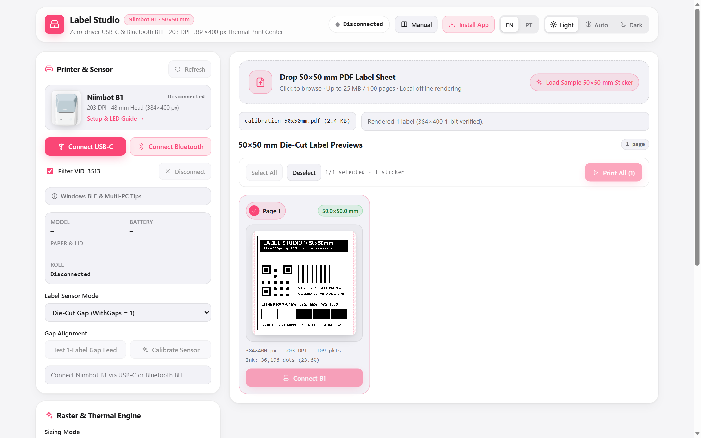
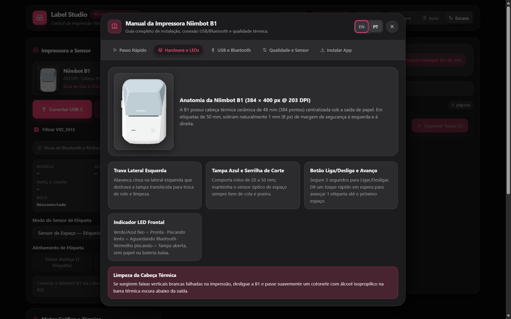
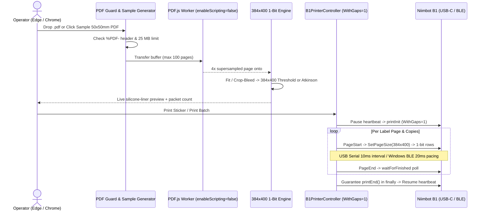

# Label Studio — Niimbot B1 50×50 mm PDF Thermal Printer PWA

[](https://github.com/jmiguelrj/niimbot-b1-pdf-printer/actions/workflows/ci.yml)
[](LICENSE)
[](tsconfig.json)
[](SECURITY.md)
[](src/i18n/translations.ts)

A local-first, zero-driver Progressive Web App (PWA) for printing **50×50 mm** die-cut thermal gap labels from PDFs directly to a **Niimbot B1** thermal label printer over **WebSerial (USB-C)** and **WebBluetooth (BLE)** — engineered specifically to work identically across **Windows 10/11 ARM64 (Qualcomm Snapdragon)** and **x86_64 (Intel/AMD)** machines without vendor installers or cloud uploads.

<p align="center">
  <picture>
    <source media="(prefers-color-scheme: dark)" srcset="./docs/media/showcase-dark.png" />
    <source media="(prefers-color-scheme: light)" srcset="./docs/media/showcase-light.png" />
    
  </picture>
</p>

<details>
  <summary><strong>Preview: Interactive Hardware Manual &amp; Brazilian Portuguese (PT-BR) Mode</strong></summary>
  <p align="center">
    
  </p>
</details>

---

## Why This Exists

- **Breaks the ARM64 Driver Deadlock**: Vendor desktop drivers often fail to install or print reliably on Windows on ARM64 laptops. In modern Chromium (**Microsoft Edge** or **Google Chrome `>= 117`**), the browser communicates directly with the Niimbot B1 (`VID_3513:PID_0002`) via Windows' built-in CDC-ACM serial driver (`usbser.sys`) or over BLE GATT (`e7810a71-73ae-499d-8c15-faa9aef0c3f2`). See [ADR-001](docs/adr/ADR-001-driverless-webserial-webbluetooth-arm64.md).
- **Pixel-Accurate 203 DPI Thermal Output**: Eliminates blurry OS spooler scaling and greyscale halftoning by rasterizing each PDF page client-side at 4× supersampling (`#FFFFFF` composited) and quantizing cleanly into a strict **`384 × 400 px`** 1-bit monochrome bitmap matching the B1 printhead (`48 mm` active thermal head + `1 mm` unprintable side margins × `50 mm` feed height). See [ADR-002](docs/adr/ADR-002-thermal-printhead-384px-geometry-and-binarization.md).
- **Zero-Hardware-Required Live Demo (`Sample 50×50 mm Sticker`)**: Click **Load Sample 50×50 mm Sticker** inside the dropzone (`src/pdf/samplePdf.ts`) to generate an instant `%PDF-1.4` (`141.732 × 141.732 pt`) test label with QR finder patterns, barcode bars, and a 5-step grayscale ramp (`15%`–`100%`) so anyone can compare **Sharp Threshold** vs. **Atkinson Dither** in real time without uploading a file.
- **Zero-Cloud Privacy & Offline PWA**: PDFs are parsed locally in a bundled `pdfjs-dist@6.5.438` Web Worker (`enableScripting: false`, `enableXfa: false`) and stay strictly in browser RAM. Once installed as a desktop PWA, the entire rasterizer and hardware controller run 100% offline.

---

## End-to-End Raster & Thermal Packet Pipeline



---

## Architecture & Engineering Highlights

| Layer | Implementation | Verified Contract |
| :--- | :--- | :--- |
| **Raster Engine** | [binarizer.ts](src/pdf/binarizer.ts), [rasterizer.ts](src/pdf/rasterizer.ts), [samplePdf.ts](src/pdf/samplePdf.ts) | Exact `384 × 400 px` (`B1_PRINTHEAD_PX = 384`, `LABEL_HEIGHT_PX = 400`), `fit` or `crop-bleed`, `0/90/180/270°` rotation, **Sharp Threshold** & **Atkinson** dithering, built-in 1-click calibration PDF |
| **Hardware Transport** | [b1Client.ts](src/printer/b1Client.ts), [web-hardware.d.ts](src/printer/web-hardware.d.ts) | `@mmote/niimbluelib@0.49.1` (`NiimbotSerialClient` + `NiimbotBluetoothClient`), dynamic COM discovery (`VID_3513` / `VID_1A86`), Windows BLE **`20 ms`** pacing & `30 s` page timeout |
| **Gap Alignment** | `B1PrinterController` (`LabelType.WithGaps = 1`) | Enforces `WithGaps` mode, **Feed 1 Sticker to Gap** (zero-heat alignment), **Optical Gap Calibration (`0x8E`)**, guarantees `printEnd()` cleanup in `finally` |
| **Batch Queue** | `printBatchLabels()` + `AbortController` | Single/multi-page selection, per-page copies, live packet/feed progress, and **Stop After Current** safe abort |
| **UI & Interactive Manual** | [tokens.css](src/tokens.css), [style.css](src/style.css), [icons.ts](src/ui/icons.ts), [manualModal.ts](src/ui/manualModal.ts), [main.ts](src/main.ts) | Apple macOS Sonoma / iPadOS Print Center with `#FA4676` accent, Light / Auto / Pro Dark modes, transparent vector `niimbot-b1.svg` showcase pod, 5-tab Manual, pure-DOM SVG icons (`createElementNS`) |
| **Bilingual i18n** | [translations.ts](src/i18n/translations.ts) | Zero-dependency type-safe **English (`en`)** & **Brazilian Portuguese (`pt-BR`)** live switcher (`niimbot-label-studio:locale`) with 100% key/placeholder parity tested in CI |
| **Offline PWA & Isolation** | [vite.config.ts](vite.config.ts), [manifest.webmanifest](public/manifest.webmanifest) | Zero-dependency `offlinePwaPlugin()` (`base: "./"`), explicit `id`/`scope: "./"`, scoped `niimbot-label-studio-` CacheStorage & `self.registration.scope` fetch boundaries |
| **Security & CI** | [index.html](index.html), [validation.ts](src/pdf/validation.ts), [verify-guardrails.mjs](scripts/verify-guardrails.mjs) | Strict CSP (`script-src 'self'`, `style-src 'self'`), zero `innerHTML`/`any`/`.style.*`, `MAX_PDF_BYTES = 25 MB`, `MAX_PDF_PAGES = 100`, `%PDF-` check, Biome + pre-commit hook + GitHub Actions CI |

---

## Quickstart (Local Development)

### Prerequisites
- **Node.js** `>= 24` and **npm** `>= 11` (verified on Windows 11 ARM64 with Node `v24.13.0` and Linux CI)
- **Git** `>= 2.43`
- **Microsoft Edge** or **Google Chrome** `>= 117` (required for W3C WebSerial & WebBluetooth APIs over `http://localhost` or `https://`)

### Setup & Commands
```powershell
git clone https://github.com/jmiguelrj/niimbot-b1-pdf-printer.git
cd niimbot-b1-pdf-printer
npm ci
npm run prepare   # Activates .githooks/pre-commit (runs npm run check before commits)
npm run dev       # Starts local Vite dev server on http://localhost:5173
```

### Verification & Production Build
```powershell
npm audit         # Dependency vulnerability check (0 vulnerabilities)
npm run check     # Biome lint + tsc --noEmit + verify-guardrails.mjs + 20/20 unit tests
npm run build     # Emits relative-path static PWA bundle + dist/sw.js into ./dist
```

---

## Subpath Reverse-Proxy Hosting (`/labels/`)

Because `vite.config.ts` compiles with `base: "./"` and relative service-worker entries, `./dist/` can be served from either a root domain or a subpath such as `https://labels.example.com/labels/`:

1. **Single-Hop `HTTP → HTTPS` & Trailing-Slash Redirect**: Redirect `http://.../labels` directly to `https://.../labels/` (`308`) and normalize `/labels` → `/labels/` **before** `stripprefix` so `./assets/*`, `./niimbot-b1.svg`, and `./sw.js` resolve under `/labels/`.
2. **Explicit `.mjs` MIME Type & Hardware `Permissions-Policy`**: Alpine Nginx images omit `mjs` in `/etc/nginx/mime.types` by default. Map `.mjs` explicitly to `application/javascript` so `pdf.worker.min-*.mjs` loads as an ES module worker, and emit `Permissions-Policy: serial=(self), bluetooth=(self), usb=(self)...`.

```nginx
# Excerpt — /opt/niimbot-label-studio/nginx.conf (nginx:1.27-alpine)
include /etc/nginx/mime.types;
types {
    application/javascript mjs;
    application/manifest+json webmanifest;
}

add_header Permissions-Policy "serial=(self), bluetooth=(self), usb=(self), camera=(), microphone=(), geolocation=()" always;
add_header Content-Security-Policy "default-src 'self'; script-src 'self'; worker-src 'self' blob:; style-src 'self'; img-src 'self' data: blob:; connect-src 'self'; font-src 'self'; manifest-src 'self'; object-src 'none'; base-uri 'self'; form-action 'none'; frame-ancestors 'none'" always;
```

For the full production Nginx & Traefik configuration, HSTS/CSP headers, and rollback commands, see [SOP-006](docs/SOP-006-SUBPATH-REVERSE-PROXY-DEPLOYMENT.md).

---

## Architecture Decisions, Runbooks & Governance

- **Architecture Decision Records**:
  - [ADR-001: Zero-Driver WebSerial & WebBluetooth PWA Across ARM64 & x64](docs/adr/ADR-001-driverless-webserial-webbluetooth-arm64.md)
  - [ADR-002: 384×400 px Thermal Printhead Geometry & Dual 1-Bit Binarizers](docs/adr/ADR-002-thermal-printhead-384px-geometry-and-binarization.md)
  - [ADR-003: Windows BLE GATT 20 ms Pacing, `WithGaps` Alignment & `printEnd()` Recovery](docs/adr/ADR-003-windows-ble-gatt-pacing-and-withgaps-sensor.md)
- **Operational SOPs & Registry**:
  - [Task Registry](docs/TASK_REGISTRY.md) · [SOP-001: Environment](docs/SOP-001-ENVIRONMENT-AND-SETUP.md) · [SOP-002: Raster Engine](docs/SOP-002-PDF-RASTERIZATION-50X50.md) · [SOP-003: B1 USB/BLE](docs/SOP-003-B1-USB-BLE-GAP-PRINTING.md) · [SOP-004: Multi-PC & BLE](docs/SOP-004-MULTI-PC-AND-BLUETOOTH-DEPLOYMENT.md) · [SOP-005: Guardrails](docs/SOP-005-SECURITY-AND-AGENTIC-GUARDRAILS.md) · [SOP-006: Reverse Proxy](docs/SOP-006-SUBPATH-REVERSE-PROXY-DEPLOYMENT.md)
- **Project Governance & Policies**:
  - [SECURITY.md](SECURITY.md) · [CHANGELOG.md](CHANGELOG.md) · [CONTRIBUTING.md](CONTRIBUTING.md) · [CLAUDE.md](CLAUDE.md)

---

## License

Released under the [MIT License](LICENSE).
